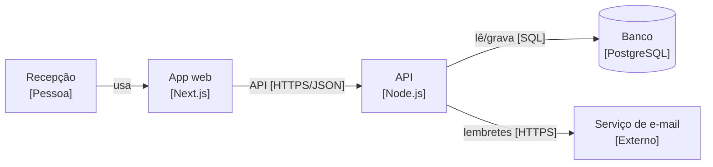

# Arquitetura de software (estilos, C4, ADRs)

> VTX-015 · Fase F2 · Base de Conhecimento. Como o **Arquiteto** desenha um sistema na VTX: escolher o estilo, desenhar com C4 e registrar decisões em ADRs. Os fluxos ([SaaS](../processos/fluxos/sistema-web-saas.md), [API](../processos/fluxos/api-integracoes.md), [manutenção](../processos/fluxos/manutencao-evolucao.md)) dizem *quando* isso acontece; este documento diz *como*. Domínio e código: [Padrões de projeto e DDD](padroes-de-projeto-ddd.md).

## 1. Conceitos essenciais
- **Arquitetura** = as decisões caras de mudar depois: divisão em partes, onde ficam os dados, como as partes conversam, onde roda.
- **Atributos de qualidade** (ISO/IEC 25010:2023): adequação funcional, desempenho, compatibilidade, capacidade de interação (usabilidade), confiabilidade, segurança, manutenibilidade, flexibilidade e *safety*. Cada projeto escolhe os **3 que mais pesam** e os transforma em metas medíveis (ex.: "p95 < 300 ms", "99,5% ao mês").
- **Trade-off:** todo estilo melhora uns atributos e piora outros. Arquitetura boa é a mais simples que atende às metas.
- **Módulo profundo** (Ousterhout): muito comportamento atrás de uma interface pequena. Vale para serviços, pacotes e funções; facilita teste e a leitura por agentes.

## 2. Estilos e quando usar

| Estilo | Usar quando | Evitar quando |
|---|---|---|
| **Monólito modular** (padrão VTX) | Quase sempre no início: 1 deploy, módulos por domínio com fronteiras claras | Times grandes e independentes já existem |
| **Camadas** (apresentação → aplicação → domínio → dados) | CRUD e sistemas simples | Regras de negócio ricas (vira "anêmico") |
| **Hexagonal / portas e adaptadores** | Domínio rico, muitas integrações; testar o núcleo sem banco nem rede | Protótipo descartável |
| **Microsserviços** | Partes com ritmo, escala ou dono diferentes, **e** CI/CD + observabilidade maduros | MVP, time pequeno, domínio ainda incerto |
| **Orientado a eventos** (fila, pub/sub) | Integração assíncrona, picos, processamento em segundo plano | Fluxo que precisa de resposta imediata e consistência forte |
| **Serverless** (funções gerenciadas) | Carga irregular, tarefas curtas, plano gratuito basta | Processos longos, latência fixa crítica, dependência de fornecedor relevante |

Regra VTX: **monólito modular primeiro** (Fowler, *MonolithFirst*); extrair um serviço só quando um módulo provar a necessidade, com ADR. Reescrita de legado: substituição gradual (*Strangler Fig*), nunca "big bang".

## 3. Modelo C4 (como desenhar)
Quatro níveis de zoom: **1 Contexto** (o sistema, usuários e sistemas externos), **2 Contêineres** (apps, APIs, bancos, filas — o que roda e se comunica), **3 Componentes** (partes de um contêiner), **4 Código**. Na VTX: **níveis 1 e 2 obrigatórios**; o 3 só para contêiner complexo; o 4 nunca à mão (sai do código).
- **Ferramenta:** Mermaid dentro do Markdown (grátis, renderiza no GitHub e no Cursor). O C4 nativo do Mermaid é experimental; usar `flowchart` com a notação C4 nos rótulos. Para sistemas grandes, Structurizr DSL local (open source).
- Cada caixa tem nome, tecnologia e responsabilidade em uma linha; cada seta diz o quê e como (ex.: "envia pedido [HTTPS/JSON]").



## 4. ADR (registro de decisão)
- **Onde:** `docs/adr/NNNN-slug.md` no repositório do projeto, numeração sequencial, nunca apagado (decisão trocada vira `substituído por ADR-NNNN`).
- **Quando escrever** — os 3 têm de ser "sim": (1) difícil de reverter; (2) surpreende quem lê sem contexto; (3) houve alternativa real. Caso típico: estilo, banco, autenticação, hospedagem, tenancy, comunicação entre módulos, desvio do caminho óbvio, restrição invisível no código. Biblioteca trivial não vira ADR (vai em `notas`).
- **Modelo** (Nygard, enxuto):
```markdown
# NNNN — <decisão em uma frase>
Status: proposto | aceito | substituído por NNNN · Data: AAAA-MM-DD
Contexto: <força e restrições, 2–4 linhas>
Decisão: <o que foi escolhido>
Alternativas: <opção — por que não>
Consequências: <o que fica mais fácil/difícil; custo; risco>
```
- **Governança:** ADR com custo, fornecedor pago, dados pessoais ou irreversível é **A2** (Samuel aprova, ver [governança](../processos/governanca-e-aprovacoes.md)); o resto é A1 (decide e registra).

## 5. Documento de arquitetura mínimo (`docs/arquitetura.md`)
1. Metas de qualidade (3, medíveis) e restrições · 2. C4 nível 1 e 2 · 3. Modelo de dados (entidades principais) · 4. Contratos (link do OpenAPI/AsyncAPI) · 5. Lista de ADRs · 6. Riscos e requisitos não funcionais (segurança, LGPD, custo). Cabe em 1–2 páginas; o resto mora nos ADRs. O índice navegável do repositório (módulos, fluxos, pontos de entrada) é o `docs/CODEBASE_MAP.md` — ver [Mapa de codebase por projeto](mapa-de-codebase.md).

## 6. Exemplo
"Agendamento para clínicas (SaaS)". Metas: isolamento entre clínicas, 99,5% ao mês, custo zero até 10 clientes. Estilo: monólito modular (módulos agenda, pacientes, lembretes), núcleo hexagonal só em agenda (regras de conflito). C4-1: recepção, profissional, serviço de e-mail. C4-2: app web, API, PostgreSQL, worker de lembretes. ADRs: 0001 monólito modular; 0002 tenancy *pool* com `tenant_id` (dados de saúde → A2); 0003 hospedagem em plano gratuito (A2 por depender de fornecedor). Microsserviços recusados: 1 time, domínio novo.

## 7. Checklist
- [ ] 3 metas de qualidade medíveis definidas
- [ ] Estilo escolhido com ADR; microsserviços só com justificativa
- [ ] C4 níveis 1 e 2 em Mermaid no repositório
- [ ] ADRs só para decisões que passam nos 3 critérios; A2 aprovadas pelo Samuel
- [ ] `docs/arquitetura.md` com dados, contratos, riscos e lista de ADRs
- [ ] Todo requisito do PRD mapeado a um contêiner/módulo

## Fontes
- Brown, S., *The C4 model*: https://c4model.com/ · Mermaid C4 (experimental): https://mermaid.js.org/syntax/c4.html · Structurizr DSL: https://docs.structurizr.com/dsl
- Nygard, M., *Documenting Architecture Decisions* (2011): https://cognitect.com/blog/2011/11/15/documenting-architecture-decisions · ADR GitHub org e MADR: https://adr.github.io/ · https://adr.github.io/madr/
- Microsoft, *Architecture styles*: https://learn.microsoft.com/en-us/azure/architecture/guide/architecture-styles/ · *Strangler Fig*: https://learn.microsoft.com/en-us/azure/architecture/patterns/strangler-fig
- Fowler, M., *MonolithFirst*: https://martinfowler.com/bliki/MonolithFirst.html · Lewis & Fowler, *Microservices*: https://martinfowler.com/articles/microservices.html
- Cockburn, A., *Hexagonal architecture*: https://alistair.cockburn.us/hexagonal-architecture/
- ISO/IEC 25010:2023 (resumo): https://iso25000.com/index.php/en/iso-25000-standards/iso-25010
- Ousterhout, J., *A Philosophy of Software Design*: https://web.stanford.edu/~ouster/cgi-bin/book.php · mattpocock/skills `domain-modeling` (ADR-FORMAT) e `codebase-design`, pin 49dd158, MIT (em avaliação)
